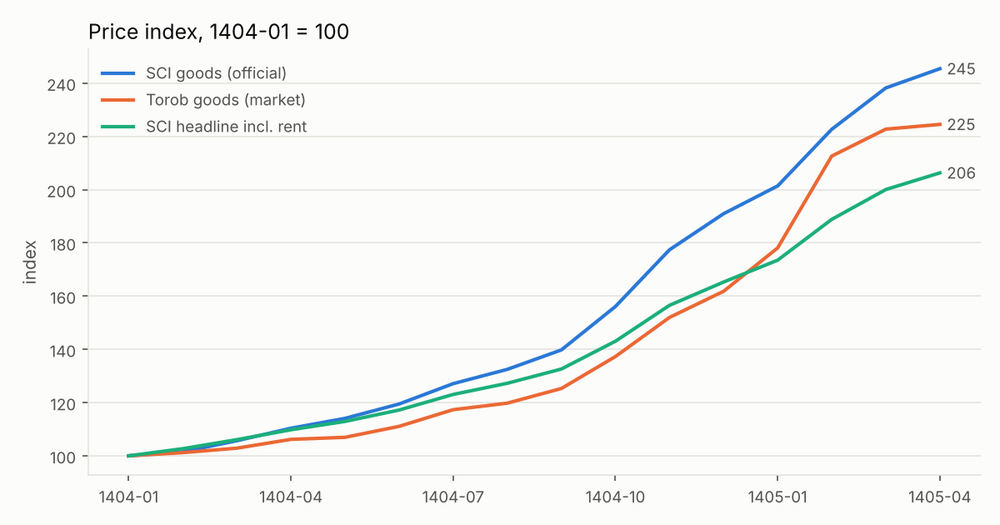
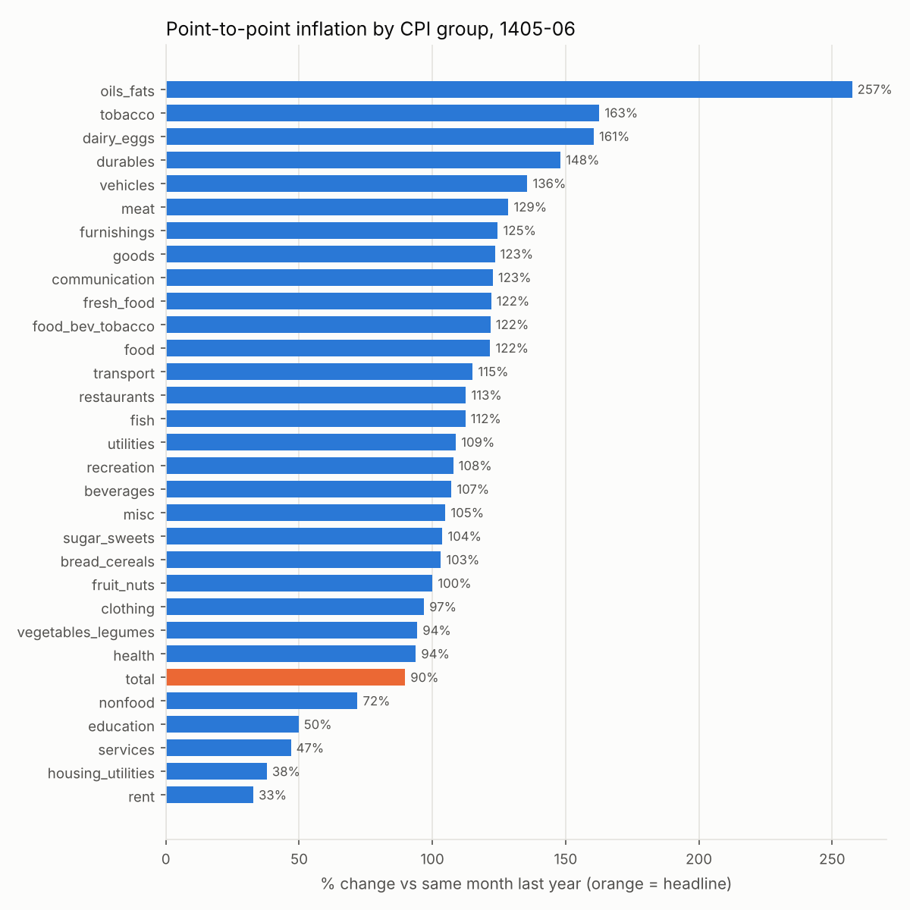
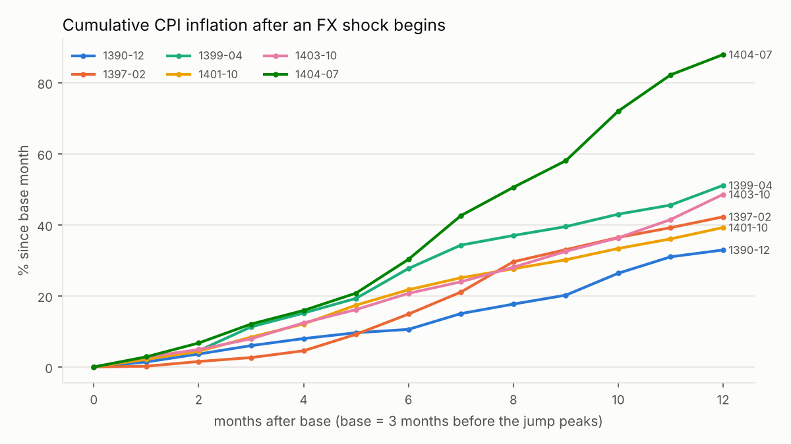

# داده‌های مدل پیش‌بینی تورم ایران

مرحله‌ی اول پروژه: جمع‌آوری و پاک‌سازی داده، و بررسی این‌که آمار رسمی تا چه حد با منابع مستقل جور درمی‌آید.

```bash
pip install -r iran_inflation/requirements.txt
python iran_inflation/collect_data.py      # دانلود منابع و ساخت data/processed/
python iran_inflation/analyze_data.py      # جدول‌ها و نمودارهای reports/
```

`collect_data.py --refresh` منابع را دوباره دانلود می‌کند. منبع دلار هر روز به‌روز می‌شود.

## منابع

همه‌ی منابع از آینه‌های عمومی GitHub خوانده می‌شوند، چون amar.org.ir، cbi.ir و tgju.org از همه‌جا در دسترس نیستند.

| کلید | محتوا | بازه | منبع |
|---|---|---|---|
| `sci` | شاخص قیمت مصرف‌کننده‌ی **مرکز آمار**، کل خانوارها، ۳۱ گروه و ۳۱ استان (پایه‌ی ۱۴۰۰) | ۱۳۹۰-۰۱ تا ۱۴۰۵-۰۶ | فایل اکسل رسمی `ts_national` در [atefekalamati/tse-inflation-analysis](https://github.com/atefekalamati/tse-inflation-analysis) |
| `cbi` | شاخص **بانک مرکزی** (شاخص تأخیر تأدیه‌ی دیون) | ۱۳۷۵-۰۱ تا ۱۴۰۵-۰۵ | [faustoh9/shakhes](https://github.com/faustoh9/shakhes) |
| `usd` | دلار **بازار آزاد** (روزانه، tgju) | ۱۳۹۰-۰۹ تا امروز | [kooroshkz/Dollar-Rial-Toman-Live-Price-Dataset](https://github.com/kooroshkz/Dollar-Rial-Toman-Live-Price-Dataset) |
| `torob` | شاخص مستقل از قیمت ۳۲۸۸ کالا در ترب | ۱۴۰۴-۰۱ تا ۱۴۰۵-۰۴ | [mahdi-nasehiyan/the-actual-cpi-in-iran](https://github.com/mahdi-nasehiyan/the-actual-cpi-in-iran) |

مخزن ترب مجوز (license) ندارد. برای همین شاخص ساخته‌شده از آن فقط در `data/raw/` نوشته می‌شود و commit نمی‌شود.

## خروجی‌ها (`data/processed/`)

- `master_monthly.csv`: جدول ماهانه‌ی اصلی مدل، با کلید ماه شمسی `ym`. ستون‌ها:
  - شاخص‌ها: `cbi_cpi`، `sci_<group>`، `usd_avg`، `usd_eom` و غیره
  - نرخ‌ها برای هر شاخص: `*_mom` (ماهانه)، `*_yoy` (نقطه‌به‌نقطه)، `*_12m_avg` (سالانه)
  - `usd_daily_vol`: نوسان روزانه‌ی دلار، به‌عنوان شاخص تنش بازار
  - `usd_partial_month`: پرچم ماه ناتمام
- `sci_cpi_groups_long.csv`: شاخص مرکز آمار برای ۳۱ گروه، به‌صورت long
- `sci_cpi_provinces_long.csv`: شاخص استانی
- `cbi_cpi_monthly.csv`، `usd_free_daily.csv`، `usd_free_monthly.csv`

## یافته‌ها

جدول کامل در `reports/data_report_tables.md` است.

### ۱. آیا آمار رسمی کمتر از واقع است؟ بله، ولی از راه **وزن مسکن**، نه قیمت کالا



- **کالاها.** از فروردین ۱۴۰۴ تا تیر ۱۴۰۵، شاخص مستقل ترب برای کالاها **۱۲۴٪** و برای خوراکی **۱۲۰٪** بالا رفته است. شاخص مرکز آمار برای همین دو گروه **۱۴۵٪** و **۱۵۵٪** است. پس برای کالاها، آمار رسمی **کمتر از بازار نیست**. همبستگی تغییرات ماهانه‌ی خوراکی بین دو منبع **۰.۸۷** است. (محدودیت ترب: فقط قیمت آنلاین است و شش دسته را پوشش می‌دهد.)
- **مسکن.** گروه مسکن، آب، برق و سوخت **۳۶٪** وزن سبد رسمی را دارد. این وزن را از خود داده‌ها بازسازی کردم، با NNLS و باقی‌مانده‌ی تقریباً صفر. تورم نقطه‌ای **اجاره** در شهریور ۱۴۰۵ فقط **۳۳٪** گزارش شده، در حالی که کالاها **۱۲۳٪** بوده‌اند. علت احتمالاً این است که شاخص اجاره، قراردادهای موجود و سقف قانونی افزایش اجاره را منعکس می‌کند. اجاره‌ی بازارِ قرارداد جدید داده‌ی مستقلی ندارد و نتوانستم آن را بسنجم.
- **نتیجه.** تورم سرخط شهریور ۱۴۰۵ **۹۰٪** است. بدون مسکن **۱۱۵٪** می‌شود. برای سبد یک خانوار کم‌درآمد (خوراکی ۴۵٪، مسکن ۲۵٪) حدود **۱۰۰٪** است. اعداد این دو سبد مثال‌اند و فرض‌هایشان در کد قابل تغییر است.
- **دو منبع رسمی هم با هم فرق دارند.** مرکز آمار در سال‌های ۱۳۹۷ تا ۱۴۰۳ به‌طور متوسط ۰.۵ تا ۱۲ واحد **کمتر** از بانک مرکزی گزارش داده و در ۱۴۰۴ و ۱۴۰۵ بیشتر. هیچ‌کدام همیشه پایین‌تر نیست.

### ۲. تورم گروه‌ها خیلی پراکنده است



در شهریور ۱۴۰۵، تورم نقطه‌ای روغن **۲۵۷٪**، لبنیات و تخم‌مرغ **۱۶۱٪**، گوشت **۱۲۹٪** و کل خوراکی **۱۲۲٪** بوده است. در مقابل، اجاره **۳۳٪** و آموزش **۵۰٪** بوده‌اند. پس مدل باید **جداگانه برای خوراکی، کالای غیرخوراکی و مسکن** پیش‌بینی کند و بعد با وزن رسمی یا وزن دلخواه کاربر آن‌ها را جمع بزند. تابع `personal_index` در `analyze_data.py` همین کار را برای هر سبد دلخواه انجام می‌دهد.

### ۳. بحران‌های گذشته برای پیش‌بینی آینده مفیدند



شش دوره‌ی شوک ارزی را با یک قاعده‌ی خودکار شناسایی کردم: رشد دلار آزاد بیش از ۲۰٪ در سه ماه.

| شروع | رشد دلار در ۱۲ ماه | تورم ۱۲ ماه | تورم خوراکی | ضریب عبور (لگاریتمی) | بیشترین تورم ماهانه |
|---|---|---|---|---|---|
| ۱۳۹۰-۱۲ (تحریم نفتی) | ۱۱۳٪ | ۳۳٪ | ۴۹٪ | ۰.۳۸ | ۵.۱٪ |
| ۱۳۹۷-۰۲ (خروج آمریکا از برجام) | ۱۵۶٪ | ۴۲٪ | ۶۳٪ | ۰.۳۷ | ۷.۰٪ |
| ۱۳۹۹-۰۴ (کرونا و فشار حداکثری) | ۶۰٪ | ۵۱٪ | ۶۳٪ | ۰.۸۸ | ۷.۰٪ |
| ۱۴۰۱-۱۰ | ۵۵٪ | ۳۹٪ | ۳۶٪ | ۰.۷۶ | ۴.۷٪ |
| ۱۴۰۳-۱۰ | ۷۸٪ | ۴۹٪ | ۶۴٪ | ۰.۶۹ | ۵.۰٪ |
| ۱۴۰۴-۰۷ (اسنپ‌بک و جنگ) | ۱۰۳٪ | **۸۸٪** | **۱۲۹٪** | **۰.۸۹** | **۹.۴٪** |

دو نکته برای مدل از این جدول درمی‌آید:

1. **ضریب عبور ارز به تورم در طول زمان تقریباً دو برابر شده است** (از ۰.۳۷ به حدود ۰.۹). اقتصاد دلاری‌تر شده و قیمت‌ها سریع‌تر به دلار واکنش نشان می‌دهند. پس داده‌ی بحران‌های قدیمی را **نباید با همان وزن** دوره‌های اخیر به کار برد. مدل باید پارامتر متغیر با زمان داشته باشد، یا با وزن نزولی به داده‌های قدیمی تخمین زده شود.
2. **رژیم کنونی از همه‌ی بحران‌های قبلی شدیدتر است.** بیشترین تورم ماهانه ۹.۴٪ بوده، در حالی که سقف دوره‌های قبل حدود ۷٪ بود. داده‌ی گذشته برای «شکل» مسیر بعد از شوک مفید است، ولی **دم بالای توزیع** را کم‌تر از واقع تخمین می‌زند. بازه‌ها باید با نوسان تصادفی (stochastic volatility) پهن شوند.

## قدم بعدی (مدل)

- **متغیر هدف.** تورم ماهانه‌ی سه جزء: خوراکی، کالای غیرخوراکی و خدمات/مسکن، از مرکز آمار. تورم نقطه‌ای شش ماه بعد از ترکیب «۶ ماه معلوم × ۶ ماه شبیه‌سازی‌شده» به دست می‌آید.
- **متغیرهای توضیحی.** رشد دلار آزاد با وقفه‌های ۰ تا ۶ ماه، نوسان روزانه‌ی دلار، و پرچم رژیم بحران.
- **روش.** BVAR یا مدل markov-switching با نوسان تصادفی، و ضرایب متغیر با زمان یا وزن نزولی. بعد بک‌تست غلتان از ۱۳۹۵ و کالیبراسیون conformal روی بازه‌ها.
- **دو داده‌ی مهم که هنوز کم است:**
  - **نقدینگی و پایه‌ی پولی**: فقط در سایت بانک مرکزی منتشر می‌شود.
  - **اجاره‌ی بازار**: مثلاً از دیوار.
