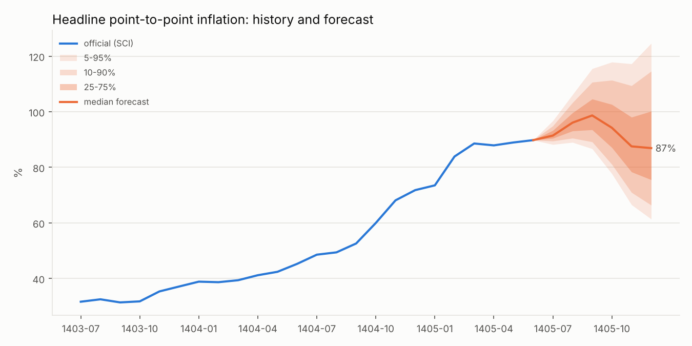
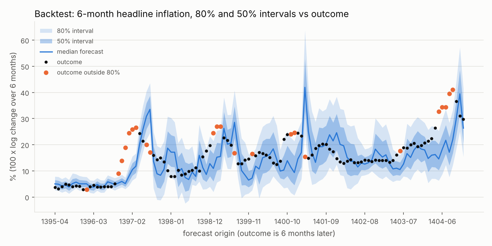

# مدل پیش‌بینی احتمالاتی تورم ایران (افق ۶ ماه)

```bash
pip install -r iran_inflation/requirements.txt
python iran_inflation/collect_data.py --refresh  # ۱. دانلود و به‌روزرسانی داده
python iran_inflation/analyze_data.py            # ۲. بررسی داده‌ها (اختیاری)
python iran_inflation/backtest.py                # ۳. آزمون روی گذشته (حدود ۲ دقیقه؛ برای کالیبره کردن سناریوها لازم است)
python iran_inflation/model.py                   # ۴. پیش‌بینی ← reports/forecast_<ماه>.md
```

هر ماه که مرکز آمار عدد جدید را منتشر کرد، مراحل ۱، ۳ و ۴ را دوباره اجرا کنید.

`collect_data.py --refresh` منابع را دوباره دانلود می‌کند. منبع دلار هر روز به‌روز می‌شود.

## منابع

همه‌ی منابع از آینه‌های عمومی GitHub خوانده می‌شوند، چون amar.org.ir، cbi.ir و tgju.org از همه‌جا در دسترس نیستند.

| کلید | محتوا | بازه | منبع |
|---|---|---|---|
| `sci` | شاخص قیمت مصرف‌کننده‌ی **مرکز آمار**، کل خانوارها، ۳۱ گروه و ۳۱ استان (پایه‌ی ۱۴۰۰) | ۱۳۹۰-۰۱ تا ۱۴۰۵-۰۶ | فایل اکسل رسمی `ts_national` در [atefekalamati/tse-inflation-analysis](https://github.com/atefekalamati/tse-inflation-analysis) |
| `cbi` | شاخص **بانک مرکزی** (شاخص تأخیر تأدیه‌ی دیون) | ۱۳۷۵-۰۱ تا ۱۴۰۵-۰۵ | [faustoh9/shakhes](https://github.com/faustoh9/shakhes) |
| `usd` | دلار **بازار آزاد** (روزانه، tgju) | ۱۳۹۰-۰۹ تا امروز | [kooroshkz/Dollar-Rial-Toman-Live-Price-Dataset](https://github.com/kooroshkz/Dollar-Rial-Toman-Live-Price-Dataset) |
| `torob` | شاخص مستقل از قیمت ۳۲۸۸ کالا در ترب | ۱۴۰۴-۰۱ تا ۱۴۰۵-۰۴ | [mahdi-nasehiyan/the-actual-cpi-in-iran](https://github.com/mahdi-nasehiyan/the-actual-cpi-in-iran) |

مخزن ترب مجوز (license) ندارد. برای همین شاخص ساخته‌شده از آن فقط در `data/raw/` نوشته می‌شود و commit نمی‌شود.

## خروجی‌ها (`data/processed/`)

- `master_monthly.csv`: جدول ماهانه‌ی اصلی مدل، با کلید ماه شمسی `ym`. ستون‌ها:
  - شاخص‌ها: `cbi_cpi`، `sci_<group>`، `usd_avg`، `usd_eom` و غیره
  - نرخ‌ها برای هر شاخص: `*_mom` (ماهانه)، `*_yoy` (نقطه‌به‌نقطه)، `*_12m_avg` (سالانه)
  - `usd_daily_vol`: نوسان روزانه‌ی دلار، به‌عنوان شاخص تنش بازار
  - `usd_partial_month`: پرچم ماه ناتمام
- `sci_cpi_groups_long.csv`: شاخص مرکز آمار برای ۳۱ گروه، به‌صورت long
- `sci_cpi_provinces_long.csv`: شاخص استانی
- `cbi_cpi_monthly.csv`، `usd_free_daily.csv`، `usd_free_monthly.csv`

## یافته‌ها

جدول کامل در `reports/data_report_tables.md` است.

### ۱. آیا آمار رسمی کمتر از واقع است؟ بله، ولی از راه **وزن مسکن**، نه قیمت کالا


- **کالاها.** از فروردین ۱۴۰۴ تا تیر ۱۴۰۵، شاخص مستقل ترب برای کالاها **۱۲۴٪** و برای خوراکی **۱۲۰٪** بالا رفته است. شاخص مرکز آمار برای همین دو گروه **۱۴۵٪** و **۱۵۵٪** است. پس برای کالاها، آمار رسمی **کمتر از بازار نیست**. همبستگی تغییرات ماهانه‌ی خوراکی بین دو منبع **۰.۸۷** است. (محدودیت ترب: فقط قیمت آنلاین است و شش دسته را پوشش می‌دهد.)
- **مسکن.** گروه مسکن، آب، برق و سوخت **۳۶٪** وزن سبد رسمی را دارد. این وزن را از خود داده‌ها بازسازی کردم، با NNLS و باقی‌مانده‌ی تقریباً صفر. تورم نقطه‌ای **اجاره** در شهریور ۱۴۰۵ فقط **۳۳٪** گزارش شده، در حالی که کالاها **۱۲۳٪** بوده‌اند. علت احتمالاً این است که شاخص اجاره، قراردادهای موجود و سقف قانونی افزایش اجاره را منعکس می‌کند. اجاره‌ی بازارِ قرارداد جدید داده‌ی مستقلی ندارد و نتوانستم آن را بسنجم.
- **نتیجه.** تورم سرخط شهریور ۱۴۰۵ **۹۰٪** است. بدون مسکن **۱۱۵٪** می‌شود. برای سبد یک خانوار کم‌درآمد (خوراکی ۴۵٪، مسکن ۲۵٪) حدود **۱۰۰٪** است. اعداد این دو سبد مثال‌اند و فرض‌هایشان در کد قابل تغییر است.
- **دو منبع رسمی هم با هم فرق دارند.** مرکز آمار در سال‌های ۱۳۹۷ تا ۱۴۰۳ به‌طور متوسط ۰.۵ تا ۱۲ واحد **کمتر** از بانک مرکزی گزارش داده و در ۱۴۰۴ و ۱۴۰۵ بیشتر. هیچ‌کدام همیشه پایین‌تر نیست.

### ۲. تورم گروه‌ها خیلی پراکنده است


در شهریور ۱۴۰۵، تورم نقطه‌ای روغن **۲۵۷٪**، لبنیات و تخم‌مرغ **۱۶۱٪**، گوشت **۱۲۹٪** و کل خوراکی **۱۲۲٪** بوده است. در مقابل، اجاره **۳۳٪** و آموزش **۵۰٪** بوده‌اند. پس مدل باید **جداگانه برای خوراکی، کالای غیرخوراکی و مسکن** پیش‌بینی کند و بعد با وزن رسمی یا وزن دلخواه کاربر آن‌ها را جمع بزند. تابع `personal_index` در `analyze_data.py` همین کار را برای هر سبد دلخواه انجام می‌دهد.

### ۳. بحران‌های گذشته برای پیش‌بینی آینده مفیدند


شش دوره‌ی شوک ارزی را با یک قاعده‌ی خودکار شناسایی کردم: رشد دلار آزاد بیش از ۲۰٪ در سه ماه.

| شروع | رشد دلار در ۱۲ ماه | تورم ۱۲ ماه | تورم خوراکی | ضریب عبور (لگاریتمی) | بیشترین تورم ماهانه |
|---|---|---|---|---|---|
| ۱۳۹۰-۱۲ (تحریم نفتی) | ۱۱۳٪ | ۳۳٪ | ۴۹٪ | ۰.۳۸ | ۵.۱٪ |
| ۱۳۹۷-۰۲ (خروج آمریکا از برجام) | ۱۵۶٪ | ۴۲٪ | ۶۳٪ | ۰.۳۷ | ۷.۰٪ |
| ۱۳۹۹-۰۴ (کرونا و فشار حداکثری) | ۶۰٪ | ۵۱٪ | ۶۳٪ | ۰.۸۸ | ۷.۰٪ |
| ۱۴۰۱-۱۰ | ۵۵٪ | ۳۹٪ | ۳۶٪ | ۰.۷۶ | ۴.۷٪ |
| ۱۴۰۳-۱۰ | ۷۸٪ | ۴۹٪ | ۶۴٪ | ۰.۶۹ | ۵.۰٪ |
| ۱۴۰۴-۰۷ (اسنپ‌بک و جنگ) | ۱۰۳٪ | **۸۸٪** | **۱۲۹٪** | **۰.۸۹** | **۹.۴٪** |

دو نکته برای مدل از این جدول درمی‌آید:

1. **ضریب عبور ارز به تورم در طول زمان تقریباً دو برابر شده است** (از ۰.۳۷ به حدود ۰.۹). اقتصاد دلاری‌تر شده و قیمت‌ها سریع‌تر به دلار واکنش نشان می‌دهند. پس داده‌ی بحران‌های قدیمی را **نباید با همان وزن** دوره‌های اخیر به کار برد. مدل باید پارامتر متغیر با زمان داشته باشد، یا با وزن نزولی به داده‌های قدیمی تخمین زده شود.
2. **رژیم کنونی از همه‌ی بحران‌های قبلی شدیدتر است.** بیشترین تورم ماهانه ۹.۴٪ بوده، در حالی که سقف دوره‌های قبل حدود ۷٪ بود. داده‌ی گذشته برای «شکل» مسیر بعد از شوک مفید است، ولی **دم بالای توزیع** را کم‌تر از واقع تخمین می‌زند. بازه‌ها باید با نوسان تصادفی (stochastic volatility) پهن شوند.

## مدل



### ساختار (`model.py`)

1. **بلوک ارز.** تغییر ماهانه‌ی دلار آزاد با یک مدل markov-switching دو رژیمی، AR(1) با میانگین و واریانس متغیر، مدل می‌شود:
   - رژیم «آرام»: حدود ۰.۸٪ در ماه با σ ≈ ۱.۹
   - رژیم «بحران»: حدود ۳.۹٪ در ماه با σ ≈ ۷.۳

   هزاران مسیر شش‌ماهه از این مدل شبیه‌سازی می‌شود. اگر ماه جاری هنوز تمام نشده، میانگین دلارِ همان روزهای سپری‌شده به‌عنوان ماه اول وارد می‌شود (nowcast).
2. **بلوک قیمت.** سه جزء سبد جداگانه مدل می‌شوند: خوراکی، مسکن و بقیه. هر جزء یک رگرسیون ridge وزن‌دار است روی این متغیرها:
   - وقفه‌های تورم خودش
   - تورم کل ماه قبل
   - تغییر دلار در ماه جاری و وقفه‌های ۱ تا ۵
   - اثر فصلی (با شرینک)

   وزن داده‌های قدیمی با **نیمه‌عمر ۵ سال** کم می‌شود، چون ضریب عبور ارز در طول زمان دو برابر شده است.
3. **شوک‌ها.** باقی‌مانده‌ها یک‌جا بازنمونه‌گیری می‌شوند (bootstrap)، یعنی هر بار یک ماه تاریخی برای هر سه جزء با هم انتخاب می‌شود تا همبستگی بین اجزا حفظ شود. این انتخاب از ماه‌هایی است که **در همان رژیم ارزی** بوده‌اند، و همین باعث می‌شود دم‌های توزیع در دوره‌ی بحران پهن‌تر باشد.
4. **تجمیع.** تورم کل و تورم هر سبد دلخواه (مثلاً خانوار کم‌درآمد) با وزن‌های سال پایه‌ی ۱۴۰۰ مرکز آمار ساخته می‌شود. تورم نقطه‌ای شش ماه بعد از ترکیب «۶ ماه معلوم × ۶ ماه شبیه‌سازی‌شده» به دست می‌آید.

### آزمون روی گذشته (`backtest.py`)

مدل برای ۱۱۷ مبدأ پیش‌بینی (۱۳۹۵-۰۴ تا ۱۴۰۴-۱۲) هر بار **فقط با داده‌ی تا همان ماه** دوباره تخمین زده شده است. هدف، تورم تجمعی شش ماه بعد است (۱۰۰ × لگاریتم).

| مدل | خطای میانه (MAE) | CRPS | پوشش بازه‌ی ۵۰٪ | پوشش ۸۰٪ | پوشش ۹۰٪ | پهنای ۸۰٪ |
|---|---|---|---|---|---|---|
| **مدل اصلی** | **۵.۵** | **۴.۱** | ۵۳٪ | **۸۰٪** | **۸۹٪** | ۱۷.۴ |
| بدون دلار | ۵.۶ | ۴.۳ | ۵۲٪ | ۷۴٪ | ۸۰٪ | ۱۴.۲ |
| گام تصادفی (ادامه‌ی میانگین ۳ ماه) | ۶.۲ | ۴.۹ | ۴۴٪ | ۶۲٪ | ۷۵٪ | ۱۲.۸ |
| مدل اصلی با **دلار واقعی از قبل معلوم** (غیرواقعی) | ۴.۳ | ۳.۲ | ۳۹٪ | ۶۷٪ | ۸۰٪ | ۱۰.۱ |
| همان، بعد از کالیبراسیون (حالت سناریو) | ۴.۸ | ۳.۵ | ۵۳٪ | ۸۳٪ | ۹۵٪ | ۱۷.۳ |



**آنچه این آزمون نشان می‌دهد:**

- **بازه‌ها صادق‌اند.** وقتی مدل می‌گوید «۸۰٪»، در عمل ۸۰٪ مواقع درست بوده است، چه در کل دوره و چه در دوره‌ی تورم بالای ۱۴۰۱ به بعد (۸۵٪). مدل‌های ساده‌تر بازه‌ی خیلی باریکی می‌دهند و فقط ۶۲ تا ۷۴٪ مواقع درست درمی‌آیند.
- **دقت نقطه‌ای سقف دارد.** میانگین خطا ±۵.۵ واحد روی تورم شش‌ماهه است، که روی تورم نقطه‌ای حدود ±۸ تا ۱۰ واحد درصد می‌شود. حتی اگر دلار آینده را دقیق می‌دانستیم، خطا فقط حدود ۲۲٪ کم می‌شد. **بیشتر عدم‌قطعیت از خود قیمت‌هاست**، نه فقط از دلار.
- **نقطه‌ی ضعف: آغاز شوک جدید.** مدل در شروع شوک‌ها جا می‌ماند: ۱۳۹۶-۱۰ تا ۱۳۹۷-۰۳ (قبل از خروج آمریکا از برجام)، ابتدای ۱۳۹۹، و ۱۴۰۴-۰۵ تا ۱۴۰۴-۰۹ (اسنپ‌بک و جنگ). درست بعد از اوج هم بیش از حد پیش‌بینی می‌کند: ۱۳۹۷-۰۶، ۱۳۹۹-۰۷، ۱۴۰۱-۰۳. این خطاها از جنس **خبر سیاسی** است و در داده‌ی گذشته دیده نمی‌شود. برای این موارد از **جدول سناریو** استفاده کنید.
- مدل به‌طور متوسط حدود ۲ واحد کمتر پیش‌بینی کرده است، چون تورم در طول دوره رو به افزایش بوده. کالیبراسیون، این سوگیری را برای سناریوها جبران می‌کند.

### پیش‌بینی فعلی (مبدأ ۱۴۰۵-۰۶، افق اسفند ۱۴۰۵)

جزئیات در `reports/forecast_1405-06.md` است. ماه اول با میانگین دلار مهر تا امروز تنظیم شده: **۲۵۷ هزار تومان**، یعنی ۱۶٪ بیشتر از شهریور.

| تورم نقطه‌ای اسفند ۱۴۰۵ | ۱۰٪ | میانه | ۹۰٪ |
|---|---|---|---|
| کل (رسمی) | ۶۶٪ | **۸۷٪** | ۱۱۵٪ |
| خوراکی | ۶۵٪ | **۹۴٪** | ۱۳۷٪ |
| مسکن | ۳۳٪ | ۳۹٪ | ۴۷٪ |
| سبد خانوار کم‌درآمد | ۶۸٪ | **۹۱٪** | ۱۲۳٪ |

| احتمال تورم نقطه‌ای کل در اسفند ۱۴۰۵ | زیر ۷۰٪ | ۷۰ تا ۸۰٪ | ۸۰ تا ۹۰٪ | ۹۰ تا ۱۰۰٪ | ۱۰۰ تا ۱۲۰٪ | بالای ۱۲۰٪ |
|---|---|---|---|---|---|---|
| | ۱۵٪ | ۲۰٪ | ۲۲٪ | ۱۸٪ | ۱۸٪ | ۷٪ |

**سناریوهای دلار** (بازه‌ها کالیبره شده‌اند):

| سناریو (از آبان تا اسفند) | دلار اسفند (هزار تومان) | ۱۰٪ | میانه | ۹۰٪ |
|---|---|---|---|---|
| توافق، ماهی ۳٪ ارزان‌تر | ۲۲۱ | ۵۵٪ | ۶۵٪ | ۸۰٪ |
| دلار ثابت | ۲۵۷ | ۶۲٪ | ۷۳٪ | ۸۸٪ |
| ماهی ۳٪ گران‌تر | ۲۹۸ | ۶۹٪ | ۸۱٪ | ۹۷٪ |
| تشدید بحران، ماهی ۸٪ | ۳۷۸ | ۸۰٪ | ۹۴٪ | ۱۱۴٪ |

**چرا میانه اول بالا می‌رود و بعد پایین می‌آید؟** (نمودار بالا) تورم نقطه‌ای حدود آذر به اوج نزدیک ۱۰۰٪ می‌رسد و بعد پایین می‌آید. علتش «اثر پایه» است: ماه‌های دی و بهمن ۱۴۰۴ تورم ماهانه‌ی ۷.۹٪ و ۹.۴٪ داشتند. وقتی این دو ماه از پنجره‌ی دوازده‌ماهه خارج شوند، عدد نقطه‌ای حتی با تورم ماهانه‌ی بالا هم افت می‌کند.

### محدودیت‌ها

- **هدف مدل، شاخص رسمی مرکز آمار است**، چون تنها سری بلند و گروه‌بندی‌شده‌ای است که وجود دارد. اگر فکر می‌کنید اجاره کمتر از واقع گزارش می‌شود، به ردیف «خوراکی» یا «سبد کم‌درآمد» نگاه کنید، یا وزن دلخواه بدهید: `Forecast.yoy_at_horizon(basket)`.
- **نقدینگی و پایه‌ی پولی** هنوز در مدل نیستند (داده در دسترس نبود). اثرشان تا حدی از راه دلار وارد مدل می‌شود.
- **شکست ساختاری بی‌سابقه.** اگر شوکی رخ دهد که هیچ نمونه‌ای در گذشته ندارد، مثلاً تورم ماهانه‌ی بالای ۱۰٪، دم بالای توزیع کمتر از واقع برآورد می‌شود.
